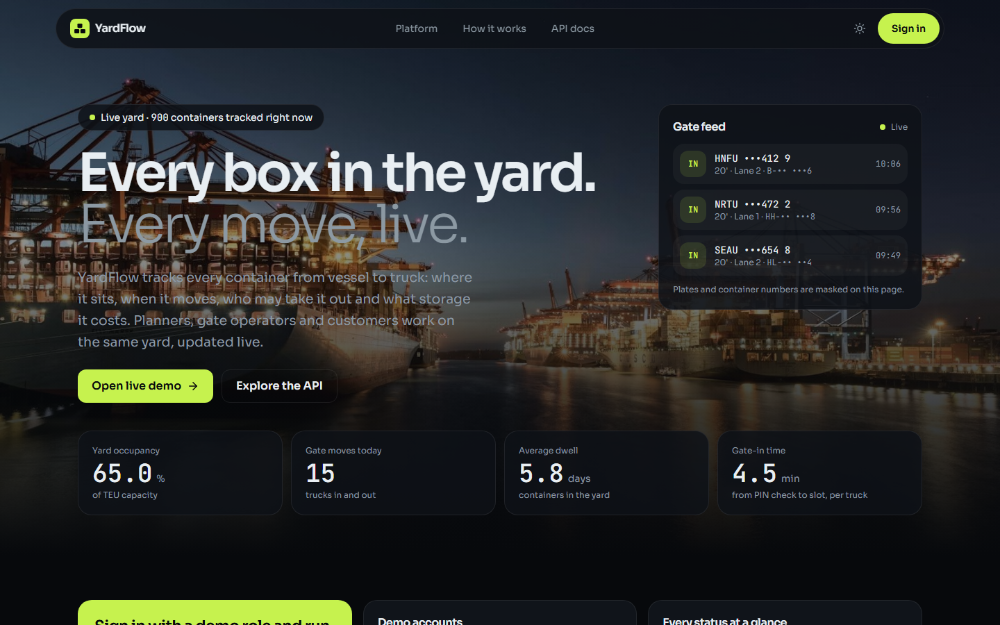
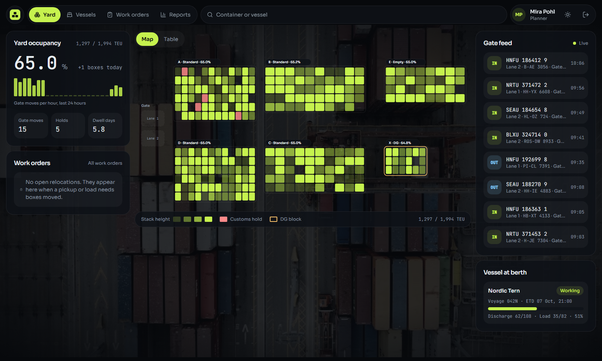
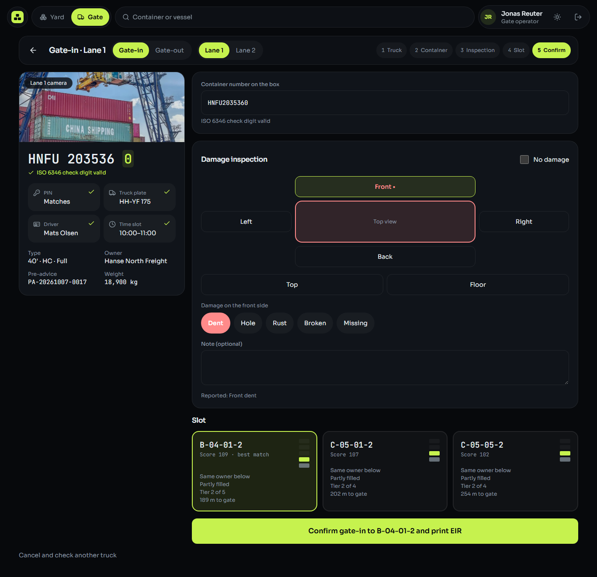
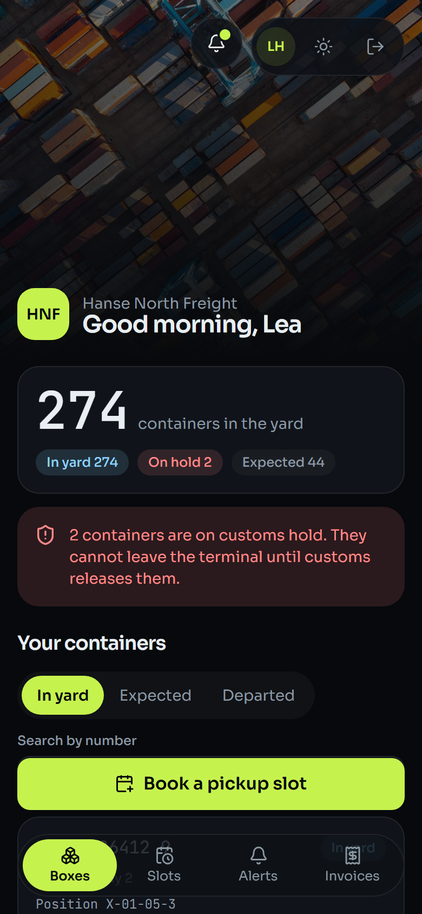
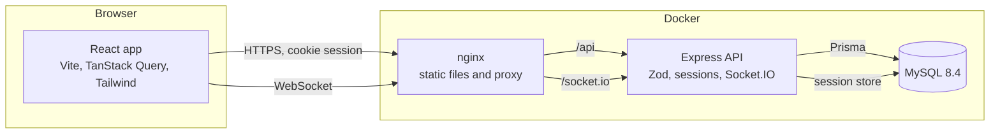
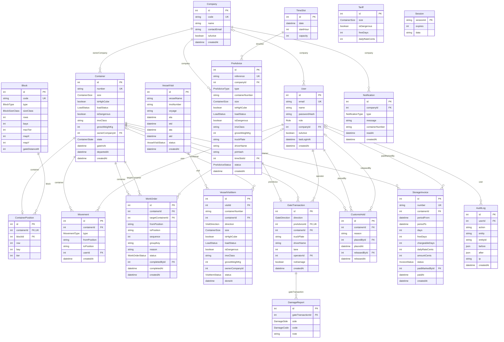

# YardFlow

[](https://github.com/YOUR-GITHUB-USER/yardflow/actions/workflows/ci.yml)

YardFlow is a container yard management system for one small container terminal. It knows where every container sits, lets trucks in and out through a PIN-checked gate, discharges and loads vessels, plans the relocations needed to dig a box out of a stack, stops containers on customs hold, and bills storage. Planners, gate operators and customers work on the same yard, and every change appears live on every open screen. It is a portfolio project built with Node.js, Express, Prisma, MySQL and React.

## Screenshots

| Landing page | Planner overview |
|---|---|
|  |  |

| Gate-in on a tablet | Customer portal on a phone |
|---|---|
|  |  |

The screenshots are made by Playwright from the seeded demo (`npm run screenshots`).

## Live demo and demo logins

Live demo: not deployed yet. [docs/DEPLOY.md](docs/DEPLOY.md) describes the Railway setup; the link goes here after the first deploy.

Every demo account uses the password `demo1234`.

| Role | Email |
|---|---|
| Admin | `admin@yardflow.dev` |
| Planner | `planner@yardflow.dev` |
| Gate operator | `gate@yardflow.dev` |
| Customer (Hanse North Freight) | `ops@hansenorth.example` |

The seed prints two gate bookings in the current or next time slot:

| Booking | Truck plate | PIN | Driver |
|---|---|---|---|
| Pickup of `HNFU 204571 1`, two containers on top of it | `HH-YF 482` | `482913` | Jan Becker |
| Delivery of a 40 ft container | `HH-YF 175` | `175824` | Mats Olsen |

## Features by role

**Planner**
- Live yard map drawn from the real block layout, stack shading by height, holds and the DG block marked, table view for keyboard users
- Stack side view, top-container moves with slot suggestions
- Vessel visits with discharge and load lists, CSV import, confirmation with suggested slots
- Relocation work orders, completed strictly from the top of the stack down
- KPIs, charts and CSV exports

**Gate operator** (tablet first)
- Truck check by plate and 6-digit PIN, with a lockout after wrong PINs
- Gate-in: live ISO 6346 check, damage inspection per side, top 3 slot suggestions, EIR ticket as PDF
- Gate-out: four checks (pre-advice, truck and driver, customs, paid invoice) with the reason for each, waiting for relocations, EIR ticket

**Customer** (phone first)
- Own containers only, with status, days in the yard, invoice and booking state
- Pickup and delivery booking with a slot picker and a PIN shown once
- Live alerts for arrivals, holds, releases, invoices and expired bookings
- Storage invoices with PDF

**Admin**
- Users, companies, blocks, tariffs and weekly time slot capacity
- Customs holds and marking invoices as paid
- Audit log of every change and login, with filters and CSV export

## Architecture



- **API modules** each have routes, a controller, a service and Zod schemas. Business rules live in services, pure algorithms in their own files without database access.
- **Events** are published after a transaction commits and sent to the Socket.IO rooms `staff` and `company:<id>`. The web app only uses them to refresh its query caches.
- **Customers are scoped to their company in every query.** Asking for another company's container answers `404`, so ids do not leak.

## Data model

Generated from `apps/api/prisma/schema.prisma` with `npm run docs:erd`.

<!-- erd:start -->



<!-- erd:end -->

## The three algorithms

**ISO 6346 check digit** (`packages/shared/src/iso6346.js`). Letters get values from A = 10 upwards, skipping multiples of 11 (so K = 21, U = 32, Z = 38). The first ten characters are weighted by their position:

```
sum = Σ value(cᵢ) · 2^i      for i = 0 … 9
check digit = (sum mod 11) mod 10
```

`HNFU2045711` has the sum 3620, and 3620 mod 11 = 1, so the check digit is 1.

**Slot suggestion** (`apps/api/src/modules/yard/slot-suggestion.js`). Only blocks of the right type (standard, empty or DG) and size class are used, and full stacks or stacks with a different top size are dropped. Each remaining stack gets a score:

```
score = 100
      + 15  if the stack is not empty
      + 20  if the top container has the same owner
      − 8 · height
      − floor(distanceM / 10)

distanceM = gateDistanceM + (bay − 1) · bayLength + (row − 1) · 3
bayLength = 7 for small blocks, 13 for large blocks
```

The top 3 by score (then distance) are offered with reasons such as "Same owner below" and "Tier 2 of 5".

**Rehandle planning** (`apps/api/src/modules/yard/rehandle.js`). To reach a container at tier `t` in a stack of height `h`, the boxes at tiers `h, h − 1, …, t + 1` must move first, top first. Each blocker becomes a work order with its sequence number and a destination from the slot suggestion, never in the source stack and never two blockers on the same tier. A pickup or load waits until all its work orders are done.

**Storage fee** (`apps/api/src/modules/billing/storage-fee.js`): `chargeableDays = max(0, days − freeDays)` and `amount = chargeableDays · dailyRate`, where a started day counts as a full day.

## Tech stack

| Layer | Choice |
|---|---|
| Runtime | Node.js 22, JavaScript ES modules |
| API | Express 5, Zod 4, express-session with a MySQL store, bcrypt, helmet, rate limiting |
| Database | MySQL 8.4 with Prisma 6 |
| Real time | Socket.IO 4, sharing the Express session |
| Documents | pdfkit (EIR ticket, invoice), csv-stringify (exports) |
| API docs | OpenAPI 3.1 with Swagger UI at `/api/docs` |
| Web | React 18, Vite, React Router, TanStack Query, Tailwind CSS, Recharts, lucide-react |
| Tests | Jest and Supertest, Vitest and Testing Library, Playwright |
| Quality | ESLint (flat config, no-comments rule), Prettier, GitHub Actions |
| Run | Docker Compose, nginx |

## Local setup in five commands

You need Node.js 22 or newer and Docker.

```bash
cp .env.example .env
npm install
npm run db:up
npm run db:reset
npm run dev
```

The web app runs on http://localhost:5173 and the API on http://localhost:4000. `npm run db:reset` applies the migrations and loads the demo data, and it prints the demo logins and PINs.

To run the whole stack in Docker instead:

```bash
docker compose up --build
```

Then open http://localhost:8080. The database is seeded on the first start.

## Testing and coverage

| Command | What runs |
|---|---|
| `npm test` | Shared, API and web tests |
| `npm run test:coverage` | The same with coverage. Jest fails below 80% lines. |
| `npm run e2e:up` then `npm run test:e2e` | Playwright against a separate Docker stack on port 8081 |
| `npm run e2e:down` | Removes the E2E stack and its data |

Coverage at the time of writing: shared 100%, API 99% of lines, web 88%.

The six Playwright flows are: admin dashboard, gate-in with a damage report and the box on the yard map, a customer booking with PIN, a customs hold that denies a gate-out until it is released, a pickup whose two blocking boxes become work orders before the gate-out completes, and a customer who cannot open another company's container. The E2E stack starts its clock on a fixed Wednesday morning, so the gate flows pass at any time of day.

## API documentation

The API is documented as OpenAPI 3.1 in `apps/api/src/openapi/openapi.yaml`. Swagger UI runs at http://localhost:4000/api/docs (or `/api/docs` behind nginx). A test fails if a route exists without documentation or the other way round.

## Project structure

```
apps/
  api/        Express API, Prisma schema, migrations, seed, Jest tests
  web/        React app, Vitest tests, Playwright E2E in e2e/
packages/
  shared/     ISO 6346, enums and schemas used by API and web
docs/
  SPEC.md DESIGN.md DECISIONS.md DEPLOY.md screenshots/
docker/       MySQL init script
docker-compose.yml, docker-compose.e2e.yml
```

## Decisions

Every choice that the specification did not fix is written down with its reason in [docs/DECISIONS.md](docs/DECISIONS.md). A few examples:

- Block rows are locked (`SELECT … FOR UPDATE`) inside each position write, so two operators cannot put two boxes on the same tier.
- Events go out only after the transaction commits, so screens never show a change that was rolled back.
- The landing page reads one public endpoint with masked plates and container numbers and a 15 second cache.
- Staff pages are loaded on demand, so the public pages stay small.
- The E2E stack uses a shifted clock instead of mocking time inside the app.

## Photo credits

All photos are from [Unsplash](https://unsplash.com) and used under the Unsplash License. Sources are listed in [apps/web/public/images/CREDITS.md](apps/web/public/images/CREDITS.md).

## License

MIT
