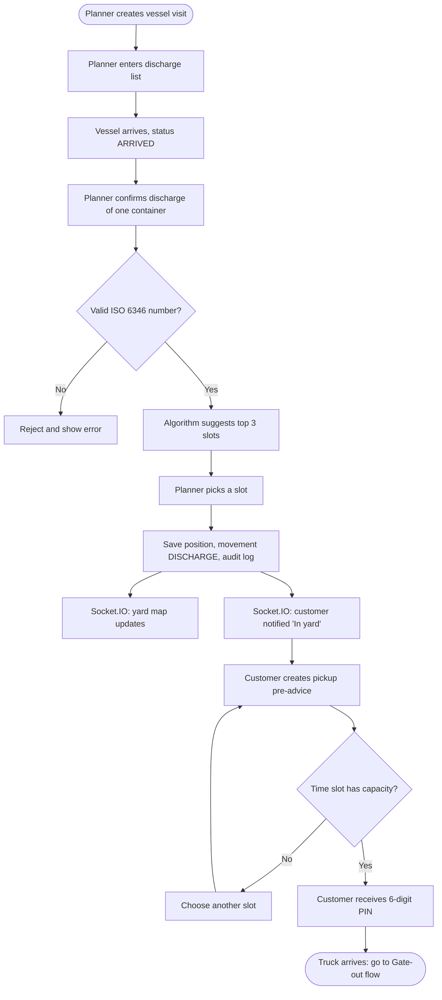
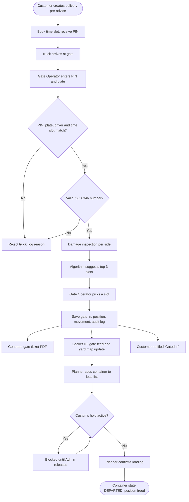
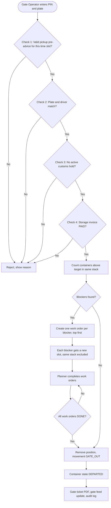
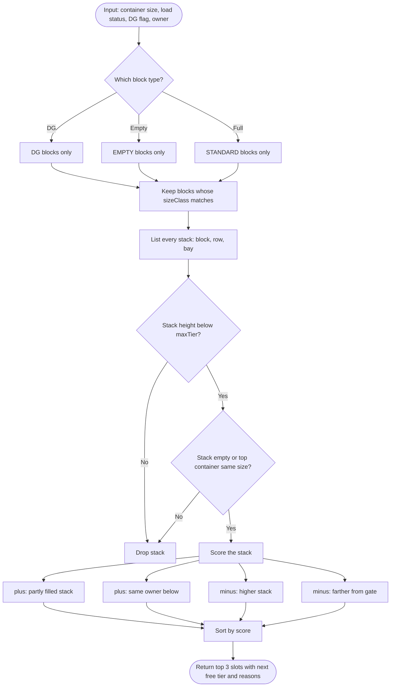
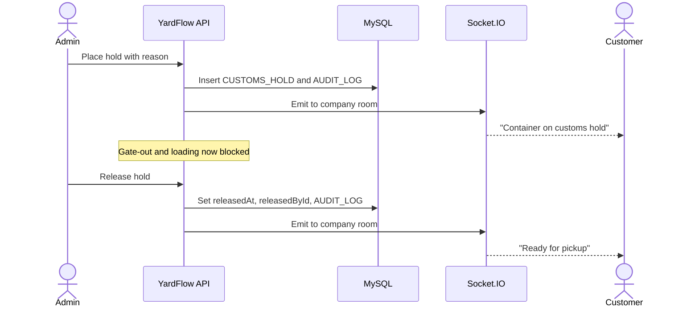
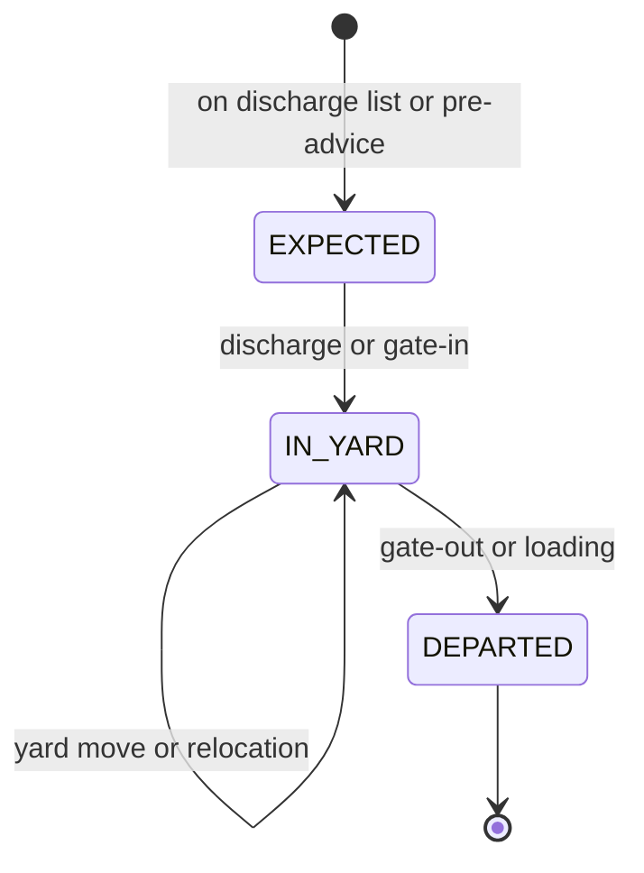

# YardFlow Specification

Version 1.0. Single source of truth for scope, data, rules and phases.

## 1. Product summary

YardFlow manages the container yard of one small container terminal. It tracks where every container sits, how it enters and leaves through the truck gate, how it moves between the yard and vessels, when customs holds it, and what storage it costs.

Four user roles work in it: Admin, Planner, Gate Operator and Customer (a freight forwarder or trucking company). Changes appear live on every open screen through Socket.IO.

The project must show a recruiter three things:

1. Clean REST API design with validation, authorization, tests and OpenAPI docs.
2. Real domain logic, not only CRUD: ISO 6346 validation, slot suggestion, relocation planning, gate rules, storage billing.
3. A polished, responsive UI in the "Night Ops" design (see `docs/DESIGN.md`).

Out of scope: payment gateways, email or SMS, multiple terminals, reefer containers, German language, mobile native apps.

## 2. Tech stack and repository

### Stack

| Layer | Choice |
|---|---|
| Runtime | Node.js 22 LTS, JavaScript ES modules |
| API | Express 5 |
| Database | MySQL 8.4 |
| ORM | Prisma |
| Validation | Zod (schemas shared between API and web where useful) |
| Auth | express-session with a MySQL-backed store (`express-mysql-session`), bcrypt |
| Real time | Socket.IO 4, sharing the Express session |
| API docs | OpenAPI 3.1 file plus `swagger-ui-express` at `/api/docs` |
| PDF | pdfkit |
| CSV | csv-stringify |
| Logging | pino and pino-http |
| Security | helmet, cors (credentials, web origin only), express-rate-limit on login and PIN checks |
| Web | React 18, Vite, React Router, TanStack Query, socket.io-client |
| Styling | Tailwind CSS with CSS variables for the theme tokens in `docs/DESIGN.md` |
| Charts | Recharts |
| Icons | lucide-react |
| Fonts | `@fontsource/sora`, `@fontsource/jetbrains-mono` (self hosted, no Google Fonts request) |
| Unit and API tests | Jest and Supertest against a real MySQL test database |
| Web component tests | Vitest and React Testing Library, for the few components with logic |
| E2E | Playwright |
| Lint and format | ESLint (flat config) and Prettier |
| CI | GitHub Actions |
| Containers | Docker Compose for local, one Dockerfile per app |

### Repository layout

npm workspaces monorepo:

```
yardflow/
  apps/
    api/
      prisma/
        schema.prisma
        migrations/
        seed.js
      src/
        app.js
        server.js
        config/
        middleware/
        modules/
          auth/ users/ companies/ blocks/ tariffs/
          containers/ yard/ workorders/ vessels/
          timeslots/ preadvices/ gate/ customs/
          billing/ notifications/ reports/ audit/
        realtime/
        openapi/
      test/
    web/
      public/images/
      src/
        app/ components/ features/ hooks/ lib/ routes/ styles/
      e2e/
  packages/
    shared/
      src/
        iso6346.js
        enums.js
        schemas/
      test/
  docs/
    SPEC.md DESIGN.md DECISIONS.md
  docker-compose.yml
  .github/workflows/ci.yml
  CLAUDE.md
  README.md
```

Each API module has the same shape: `*.routes.js`, `*.controller.js`, `*.service.js`, `*.schemas.js`. Business rules live in services. Controllers only parse input, call the service and send the response. Pure algorithms live in separate files with no database access, so they are easy to unit test (for example `yard/slot-suggestion.js`, `yard/rehandle.js`, `billing/storage-fee.js`).

### Environment variables

`.env.example` must list every variable with a safe default for local use: `DATABASE_URL`, `DATABASE_URL_TEST`, `SESSION_SECRET`, `WEB_ORIGIN`, `PORT`, `TZ=Europe/Berlin`, `GATE_SLOT_TOLERANCE_MIN=30`, `DEFAULT_SLOT_CAPACITY=10`.

## 3. Roles and permissions

| Capability | Admin | Planner | Gate Operator | Customer |
|---|---|---|---|---|
| Manage users, companies, blocks, tariffs, time slot capacity | Yes | No | No | No |
| Place and release customs holds | Yes | No | No | No |
| Mark storage invoices as paid | Yes | No | No | No |
| Vessel visits, discharge and load lists | Yes | Yes | No | No |
| Confirm discharge and loading | Yes | Yes | No | No |
| Choose slot from suggestions, move containers in the yard | Yes | Yes | Yes (at gate-in only) | No |
| Complete relocation work orders | Yes | Yes | No | No |
| Gate-in, gate-out, damage inspection, EIR ticket | Yes | No | Yes | No |
| Live yard map | Yes | Yes | Yes | No |
| Live gate feed | Yes | Yes | Yes | No |
| View containers | All | All | All | Own company only |
| Create pre-advice and book time slot | No | No | No | Own company only |
| Receive notifications | No | No | No | Own company only |
| Reports, CSV and PDF export, charts | Yes | Yes | No | Own invoices only |
| Audit log viewer | Yes | No | No | No |

Rules:

- Customers never see another company's data. Enforce this in every service query, not only in the UI. Asking for another company's container returns `404`, not `403`, so IDs do not leak.
- A customer user always belongs to one company. Staff users (Admin, Planner, Gate Operator) have no company.
- Admin creates companies and customer accounts. There is no public registration.
- Inactive users cannot log in, and their existing sessions are destroyed when they are deactivated.

## 4. Glossary

| Term | Meaning |
|---|---|
| Container number | 11 characters by ISO 6346: 3-letter owner code, 1 category letter (U, J or Z), 6-digit serial, 1 check digit. Shown as `HNFU 204571 1`, stored without spaces as `HNFU2045711`. |
| Block | A rectangular area of the yard, for example Block A. Has rows, bays and a maximum stack height. |
| Row, bay, tier | Row and bay give the ground position (the stack) inside a block. Tier is the height in the stack, 1 at the bottom. |
| Position code | `A-03-07-2` means block A, row 3, bay 7, tier 2. |
| Stack | All containers at one block, row and bay. |
| Gate-in, gate-out | A truck brings a container into the terminal, or takes one out. |
| Discharge, load | A crane moves a container from a vessel to the yard, or from the yard to a vessel. |
| Pre-advice | A customer's announcement that a truck will deliver or pick up a container in a booked time slot. |
| Time slot | A one-hour window at the gate with limited capacity. |
| EIR | Equipment Interchange Receipt. The gate ticket that records container condition at the gate. |
| Customs hold | A block placed by customs. The container may not leave the terminal while a hold is active. |
| Dwell time | Days a container stays in the yard. |
| Free days | Days of storage without charge before the daily rate starts. |
| Relocation (rehandle) | Moving containers that sit on top of the one that must leave. |
| TEU | Twenty-foot equivalent unit. 20 ft = 1 TEU, 40 ft and 45 ft = 2 TEU. |
| DG, IMO class | Dangerous goods and their class (1 to 9). |

## 5. Data model

Use this Prisma schema as the starting point. Keep names and relations. You may add indexes, `@map` names and `updatedAt` fields. Record any other change in `docs/DECISIONS.md`.

```prisma
generator client {
  provider = "prisma-client-js"
}

datasource db {
  provider = "mysql"
  url      = env("DATABASE_URL")
}

enum Role {
  ADMIN
  PLANNER
  GATE_OPERATOR
  CUSTOMER
}

enum ContainerSize {
  FT20
  FT40
  FT45
}

enum LoadStatus {
  FULL
  EMPTY
}

enum ContainerState {
  EXPECTED
  IN_YARD
  DEPARTED
}

enum BlockType {
  STANDARD
  EMPTY
  DG
}

enum BlockSizeClass {
  SMALL
  LARGE
}

enum MovementType {
  GATE_IN
  GATE_OUT
  DISCHARGE
  LOAD
  YARD_MOVE
  RELOCATION
}

enum WorkOrderStatus {
  OPEN
  DONE
  CANCELLED
}

enum VesselVisitStatus {
  PLANNED
  ARRIVED
  WORKING
  DEPARTED
}

enum VisitDirection {
  DISCHARGE
  LOAD
}

enum VisitItemStatus {
  PENDING
  DONE
}

enum PreAdviceType {
  DELIVERY
  PICKUP
}

enum PreAdviceStatus {
  ACTIVE
  USED
  CANCELLED
  EXPIRED
}

enum GateDirection {
  IN
  OUT
}

enum DamageSide {
  FRONT
  BACK
  LEFT
  RIGHT
  TOP
  FLOOR
}

enum DamageCode {
  DENT
  HOLE
  RUST
  BROKEN
  MISSING
}

enum InvoiceStatus {
  UNPAID
  PAID
  VOID
}

enum NotificationType {
  CONTAINER_IN_YARD
  READY_FOR_PICKUP
  CUSTOMS_HOLD_PLACED
  CUSTOMS_HOLD_RELEASED
  INVOICE_ISSUED
  INVOICE_PAID
  GATE_OUT_DONE
  PRE_ADVICE_EXPIRED
}

model Company {
  id            Int             @id @default(autoincrement())
  code          String          @unique @db.VarChar(3)
  name          String
  contactEmail  String
  isActive      Boolean         @default(true)
  users         User[]
  containers    Container[]
  preAdvices    PreAdvice[]
  notifications Notification[]
  createdAt     DateTime        @default(now())
}

model User {
  id                 Int               @id @default(autoincrement())
  email              String            @unique
  name               String
  passwordHash       String
  role               Role
  companyId          Int?
  company            Company?          @relation(fields: [companyId], references: [id])
  isActive           Boolean           @default(true)
  movements          Movement[]
  gateTransactions   GateTransaction[]
  completedOrders    WorkOrder[]       @relation("CompletedBy")
  placedHolds        CustomsHold[]     @relation("PlacedBy")
  releasedHolds      CustomsHold[]     @relation("ReleasedBy")
  paidInvoices       StorageInvoice[]  @relation("PaidMarkedBy")
  auditLogs          AuditLog[]
  lastLoginAt        DateTime?
  createdAt          DateTime          @default(now())
}

model Block {
  id             Int                 @id @default(autoincrement())
  code           String              @unique @db.VarChar(2)
  type           BlockType
  sizeClass      BlockSizeClass
  rows           Int
  bays           Int
  maxTier        Int
  mapX           Int
  mapY           Int
  gateDistanceM  Int
  positions      ContainerPosition[]
}

model Container {
  id               Int                 @id @default(autoincrement())
  number           String              @unique @db.VarChar(11)
  size             ContainerSize
  isHighCube       Boolean             @default(false)
  loadStatus       LoadStatus
  isDangerous      Boolean             @default(false)
  imoClass         String?             @db.VarChar(4)
  grossWeightKg    Int?
  ownerCompanyId   Int
  ownerCompany     Company             @relation(fields: [ownerCompanyId], references: [id])
  state            ContainerState      @default(EXPECTED)
  gateInAt         DateTime?
  departedAt       DateTime?
  position         ContainerPosition?
  movements        Movement[]
  workOrders       WorkOrder[]
  holds            CustomsHold[]
  invoices         StorageInvoice[]
  gateTransactions GateTransaction[]
  visitItems       VesselVisitItem[]
  createdAt        DateTime            @default(now())
}

model ContainerPosition {
  id          Int       @id @default(autoincrement())
  containerId Int       @unique
  container   Container @relation(fields: [containerId], references: [id])
  blockId     Int
  block       Block     @relation(fields: [blockId], references: [id])
  row         Int
  bay         Int
  tier        Int

  @@unique([blockId, row, bay, tier])
  @@index([blockId, row, bay])
}

model Movement {
  id           Int          @id @default(autoincrement())
  containerId  Int
  container    Container    @relation(fields: [containerId], references: [id])
  type         MovementType
  fromPosition String?      @db.VarChar(16)
  toPosition   String?      @db.VarChar(16)
  userId       Int
  user         User         @relation(fields: [userId], references: [id])
  createdAt    DateTime     @default(now())

  @@index([createdAt])
}

model WorkOrder {
  id              Int             @id @default(autoincrement())
  containerId     Int
  container       Container       @relation(fields: [containerId], references: [id])
  fromPosition    String          @db.VarChar(16)
  toPosition      String          @db.VarChar(16)
  sequence        Int
  groupKey        String          @db.VarChar(36)
  reason          String
  status          WorkOrderStatus @default(OPEN)
  completedById   Int?
  completedBy     User?           @relation("CompletedBy", fields: [completedById], references: [id])
  completedAt     DateTime?
  createdAt       DateTime        @default(now())

  @@index([groupKey])
}

model VesselVisit {
  id         Int               @id @default(autoincrement())
  vesselName String
  imoNumber  String            @db.VarChar(7)
  voyage     String            @db.VarChar(10)
  eta        DateTime
  etd        DateTime
  ata        DateTime?
  atd        DateTime?
  status     VesselVisitStatus @default(PLANNED)
  items      VesselVisitItem[]
  createdAt  DateTime          @default(now())
}

model VesselVisitItem {
  id              Int             @id @default(autoincrement())
  visitId         Int
  visit           VesselVisit     @relation(fields: [visitId], references: [id])
  containerNumber String          @db.VarChar(11)
  containerId     Int?
  container       Container?      @relation(fields: [containerId], references: [id])
  direction       VisitDirection
  size            ContainerSize
  isHighCube      Boolean         @default(false)
  loadStatus      LoadStatus
  isDangerous     Boolean         @default(false)
  imoClass        String?         @db.VarChar(4)
  grossWeightKg   Int?
  ownerCompanyId  Int
  status          VisitItemStatus @default(PENDING)
  doneAt          DateTime?

  @@unique([visitId, containerNumber, direction])
}

model TimeSlot {
  id         Int         @id @default(autoincrement())
  date       DateTime    @db.Date
  startHour  Int
  capacity   Int
  preAdvices PreAdvice[]

  @@unique([date, startHour])
}

model PreAdvice {
  id              Int              @id @default(autoincrement())
  reference       String           @unique @db.VarChar(20)
  companyId       Int
  company         Company          @relation(fields: [companyId], references: [id])
  type            PreAdviceType
  containerNumber String           @db.VarChar(11)
  size            ContainerSize?
  isHighCube      Boolean?
  loadStatus      LoadStatus?
  isDangerous     Boolean?
  imoClass        String?          @db.VarChar(4)
  grossWeightKg   Int?
  truckPlate      String           @db.VarChar(15)
  driverName      String
  pinHash         String
  timeSlotId      Int
  timeSlot        TimeSlot         @relation(fields: [timeSlotId], references: [id])
  status          PreAdviceStatus  @default(ACTIVE)
  gateTransaction GateTransaction?
  createdAt       DateTime         @default(now())
}

model GateTransaction {
  id           Int            @id @default(autoincrement())
  direction    GateDirection
  preAdviceId  Int            @unique
  preAdvice    PreAdvice      @relation(fields: [preAdviceId], references: [id])
  containerId  Int
  container    Container      @relation(fields: [containerId], references: [id])
  truckPlate   String         @db.VarChar(15)
  driverName   String
  lane         Int
  operatorId   Int
  operator     User           @relation(fields: [operatorId], references: [id])
  damages      DamageReport[]
  noDamage     Boolean        @default(false)
  createdAt    DateTime       @default(now())
}

model DamageReport {
  id                Int             @id @default(autoincrement())
  gateTransactionId Int
  gateTransaction   GateTransaction @relation(fields: [gateTransactionId], references: [id])
  side              DamageSide
  code              DamageCode
  note              String?
}

model CustomsHold {
  id           Int       @id @default(autoincrement())
  containerId  Int
  container    Container @relation(fields: [containerId], references: [id])
  reason       String
  placedById   Int
  placedBy     User      @relation("PlacedBy", fields: [placedById], references: [id])
  placedAt     DateTime  @default(now())
  releasedById Int?
  releasedBy   User?     @relation("ReleasedBy", fields: [releasedById], references: [id])
  releasedAt   DateTime?

  @@index([containerId, releasedAt])
}

model StorageInvoice {
  id             Int           @id @default(autoincrement())
  number         String        @unique @db.VarChar(20)
  containerId    Int
  container      Container     @relation(fields: [containerId], references: [id])
  periodFrom     DateTime
  periodTo       DateTime
  days           Int
  freeDays       Int
  chargeableDays Int
  dailyRateCents Int
  amountCents    Int
  status         InvoiceStatus @default(UNPAID)
  paidMarkedById Int?
  paidMarkedBy   User?         @relation("PaidMarkedBy", fields: [paidMarkedById], references: [id])
  paidAt         DateTime?
  createdAt      DateTime      @default(now())
}

model Tariff {
  id             Int           @id @default(autoincrement())
  size           ContainerSize
  isDangerous    Boolean
  freeDays       Int
  dailyRateCents Int

  @@unique([size, isDangerous])
}

model Notification {
  id        Int              @id @default(autoincrement())
  companyId Int
  company   Company          @relation(fields: [companyId], references: [id])
  type      NotificationType
  message   String
  containerNumber String?    @db.VarChar(11)
  readAt    DateTime?
  createdAt DateTime         @default(now())

  @@index([companyId, readAt])
}

model AuditLog {
  id        Int      @id @default(autoincrement())
  userId    Int?
  user      User?    @relation(fields: [userId], references: [id])
  action    String
  entity    String
  entityId  String
  before    Json?
  after     Json?
  ip        String?
  createdAt DateTime @default(now())

  @@index([entity, entityId])
  @@index([createdAt])
}
```

Money is stored in euro cents as integers. Never use floats for money.

`BlockSizeClass.SMALL` holds 20 ft containers. `LARGE` holds 40 ft and 45 ft containers, but a 45 ft container may only sit on another 45 ft container (see stacking rules).

## 6. Business rules

### 6.1 Container number

- Normalize input: uppercase, remove spaces.
- Valid only if it matches `^[A-Z]{3}[UJZ]\d{7}$` and the check digit is correct (algorithm in 8.1).
- Every form and endpoint that accepts a container number rejects an invalid one with `422` and the message `Invalid container number: check digit does not match` or `Invalid container number format`.
- Display format everywhere: `ABCU 123456 7`.

### 6.2 Container state

- `EXPECTED`: known from a discharge list or delivery pre-advice, not yet in the yard. No position.
- `IN_YARD`: has exactly one position.
- `DEPARTED`: left by gate-out or loading. Position row is deleted. `departedAt` set.
- A customs hold is not a state. It is an active `CustomsHold` row (`releasedAt` is null).
- A container number may be `IN_YARD` only once at a time. A departed container may come back later (same number, new visit). Reuse the same `Container` row and reset `state`, `gateInAt`, `departedAt`.

### 6.3 Stacking rules (hard rules)

A container may be placed on a stack only if all of these are true:

1. Block type matches: dangerous goods go only to `DG` blocks. Empty non-DG containers go only to `EMPTY` blocks. Full non-DG containers go only to `STANDARD` blocks.
2. Block size class matches: 20 ft to `SMALL`, 40 ft and 45 ft to `LARGE`.
3. The stack height is below the block's `maxTier`.
4. The stack is empty, or the top container has the same `size` (20 on 20, 40 on 40, 45 on 45).
5. The new tier is always current stack height plus one. No gaps. No placement under another container.

Row and bay must be inside the block's `rows` and `bays`. A move that breaks a rule returns `409` with the broken rule named in the message.

### 6.4 Moving a container inside the yard

- Only the top container of a stack can be moved. Moving a container that has containers above it returns `409 Container is blocked by N containers above it`.
- A move creates a `Movement` (type `YARD_MOVE` or `RELOCATION`) and an audit log entry, and emits a yard update event.
- All writes that change positions run in one Prisma transaction. Two users placing into the same slot at once must not both succeed: rely on the unique index on position and return `409 Slot was just taken, please pick another` on conflict.

### 6.5 Relocation work orders

- When a gate-out or a load is requested for a container that has containers above it, the system creates one work order per blocking container, in a single `groupKey`, ordered from the top down (`sequence` 1 is the top container).
- The destination for each blocker is the best slot from the suggestion algorithm, excluding the source stack.
- Work orders must be completed in sequence order. Completing sequence 2 before 1 returns `409`.
- Completing a work order moves the container (type `RELOCATION`). If its planned destination is no longer valid, the service picks the next best slot and records the change in the audit log.
- The gate-out or load of the target container is refused while any work order in its group is `OPEN`.
- Cancelling a pickup pre-advice cancels its open work orders.

### 6.6 Time slots

- Slots are hourly from 08:00 to 17:00 (last slot 16:00 to 17:00), Monday to Saturday, in the terminal time zone `Europe/Berlin`.
- Slots are created on demand for the next 14 days with `DEFAULT_SLOT_CAPACITY`. Admin can change the capacity of a single slot or of a whole day. Capacity can never be set below the number of active bookings.
- A slot is full when its count of `ACTIVE` plus `USED` pre-advices equals capacity.
- Customers can book from tomorrow 00:00 up to 14 days ahead, or today if the slot starts at least 60 minutes from now.

### 6.7 Pre-advice

- Created by a customer for its own company only.
- Reference format: `PA-YYYYMMDD-NNNN`, running number per day.
- The API generates a random 6-digit PIN, stores its bcrypt hash, and returns the plain PIN exactly once in the create response. The customer can regenerate the PIN, which invalidates the old one.
- `DELIVERY` (export): container number, size, high cube, load status, DG flag and IMO class, gross weight are required. The container must not already be `IN_YARD`.
- `PICKUP` (import): the container must be `IN_YARD`, owned by the customer's company. On creation, the system issues a storage invoice for the period from `gateInAt` to the end of the booked slot (see 6.10).
- One `ACTIVE` pre-advice per container at a time.
- A pre-advice expires automatically when its slot end plus tolerance has passed. Run expiry on a timer every 5 minutes and also lazily when reading. Expired pickups cancel open work orders and notify the company.

### 6.8 Gate-in (delivery)

Steps on the Gate screen:

1. **Truck**: operator enters truck plate and PIN. Look up the `ACTIVE` `DELIVERY` pre-advice by plate whose slot is today and the current time is within slot start minus tolerance and slot end plus tolerance (`GATE_SLOT_TOLERANCE_MIN`). Compare the PIN with bcrypt. Five wrong PINs for one plate in 15 minutes lock that plate for 15 minutes.
2. **Container**: operator confirms or types the container number. It must match the pre-advice and pass ISO 6346.
3. **Inspection**: operator marks damage per side with codes, or ticks "No damage". At least one of the two is required.
4. **Slot**: the system shows the top 3 suggestions (8.2). The operator picks one or enters a manual position that passes the stacking rules.
5. **Confirm**: in one transaction: create or reuse the container with the pre-advice data, set `IN_YARD`, `gateInAt = now`, create position, gate transaction, damage reports, movement `GATE_IN`, mark pre-advice `USED`, audit log. Then emit yard and gate events, notify the company (`CONTAINER_IN_YARD`), and return a link to the EIR PDF.

### 6.9 Gate-out (pickup)

Step 1 is the same truck and PIN check with a `PICKUP` pre-advice. Then all four checks run and the screen shows each one with pass or fail and a reason:

1. **Valid pre-advice** for this plate in the current slot window.
2. **Truck plate and driver name** match the pre-advice (driver name compared case-insensitively, trimmed).
3. **No active customs hold** on the container.
4. **Storage invoice paid** and its `periodTo` is on or after now. If the truck is later than the paid period, the invoice is voided and a new one is issued for the extra days, and the check fails until it is paid.

If all four pass and the container has blockers, the system creates relocation work orders (6.5) and the screen shows "Waiting for 2 relocations" with live updates. When the last work order is done, the operator can complete the gate-out.

Completing gate-out, in one transaction: delete the position, set `DEPARTED`, create gate transaction and movement `GATE_OUT`, mark pre-advice `USED`, audit log. Emit events, notify `GATE_OUT_DONE`, return EIR PDF link.

A failed check writes an audit log entry `GATE_OUT_DENIED` with the failed checks, and emits a gate event of kind `DENIED` so it appears in the live gate feed.

### 6.10 Storage billing

- Tariffs exist for each `(size, isDangerous)` pair. Seed values: 20 ft 5 free days 900 cents per day, 40 ft 5 free days 1500, 45 ft 5 free days 1700, dangerous goods 3 free days with double the rate of their size.
- `days = ceil((periodTo - gateInAt) / 24h)`, minimum 1.
- `chargeableDays = max(0, days - freeDays)`.
- `amountCents = chargeableDays * dailyRateCents`.
- An invoice with `amountCents = 0` is created with status `PAID` automatically, so free pickups pass check 4 without Admin work.
- Invoice number format: `INV-YYYY-NNNNN`.
- Only Admin marks invoices paid. Marking paid notifies the company (`INVOICE_PAID`).

### 6.11 Customs holds

- Admin places a hold with a reason on an `EXPECTED` or `IN_YARD` container. Only one active hold per container.
- Admin releases a hold. Release requires the hold to be active.
- An active hold blocks gate-out (check 3) and loading.
- Placing and releasing notify the owner company (`CUSTOMS_HOLD_PLACED`, `CUSTOMS_HOLD_RELEASED`) and update the yard map live.
- When the last active hold is released and the container has an active pickup pre-advice, also notify `READY_FOR_PICKUP`.

### 6.12 Vessel visits

- Planner creates a visit with vessel name, IMO number (7 digits), voyage, ETA and ETD.
- Planner adds discharge and load list items by form or by CSV upload with columns `containerNumber,size,isHighCube,loadStatus,isDangerous,imoClass,grossWeightKg,ownerCode,direction`. Invalid rows are reported per line and nothing is imported if any row is invalid.
- Status flow: `PLANNED` to `ARRIVED` (sets `ata`) to `WORKING` (first discharge or load) to `DEPARTED` (sets `atd`). A visit cannot depart while load items are `PENDING` unless the Planner confirms "Depart with open items", which is audit logged.
- **Confirm discharge** of one item: the Planner picks one of the top 3 slots. Creates or reuses the container as `IN_YARD`, position, movement `DISCHARGE`, item `DONE`, notify owner `CONTAINER_IN_YARD`.
- **Confirm load** of one item: container must be `IN_YARD`, no active customs hold, no blockers (otherwise relocation work orders are created like 6.5). Deletes position, `DEPARTED`, movement `LOAD`, item `DONE`.

### 6.13 Notifications

- Stored per company, emitted live to the company room.
- Customer can list, mark one as read, and mark all as read. Badge shows unread count.

### 6.14 Audit log

- Every create, update, delete and every business action (gate, move, hold, invoice, work order, login, logout, failed login) writes one audit row with `before` and `after` JSON where it makes sense. Never store password hashes, PINs or PIN hashes in audit JSON.
- Admin can filter by user, entity, action and date range, and export the result as CSV.

### 6.15 API conventions

- Base path `/api/v1`. JSON only.
- Errors: `{ "error": { "code": "SLOT_TAKEN", "message": "Slot was just taken, please pick another", "details": [] } }`.
- Status codes: `400` malformed, `401` not logged in, `403` wrong role, `404` not found or not yours, `409` business rule conflict, `422` validation failed, `429` rate limit.
- Lists support `?page=1&pageSize=25&sort=field:asc` and return `{ data, page, pageSize, total }`.
- Dates in ISO 8601 UTC in the API. The web formats them in `Europe/Berlin`.

## 7. Flows

These diagrams are part of the spec. Copy them into the README.

### 7.1 Import (vessel to truck)



### 7.2 Export (truck to vessel)



### 7.3 Gate-out and relocation



### 7.4 Slot suggestion



### 7.5 Customs hold



### 7.6 Container states



## 8. Algorithms and required tests

Each algorithm is a pure function in its own file with no database access. The service loads data, calls the function, and writes the result.

### 8.1 ISO 6346 check digit (`packages/shared/src/iso6346.js`)

Letter values start at A = 10 and increase by one, skipping every multiple of 11 (11, 22, 33). So A = 10, B = 12, K = 21, L = 23, U = 32, V = 34, Z = 38.

For the first 10 characters, multiply each value by `2^position` (position 0 to 9) and sum. Check digit = `(sum % 11) % 10`.

Exports: `normalizeContainerNumber`, `isValidContainerNumber`, `computeCheckDigit`, `formatContainerNumber`, `letterValue`.

Required tests:

| Input | Expected |
|---|---|
| `CSQU3054383` | valid, sum 6185 |
| `csqu 305438 3` | valid after normalizing |
| `HNFU2045711` | valid, sum 3620 |
| `NRTU5530180` | valid, sum 5247 |
| `HNFU0000030` | valid, sum 1924, remainder 10 gives check digit 0 |
| `CSQU3054384` | invalid check digit |
| `CSQ3054383` | invalid format |
| `CSQX3054383` | invalid format (category must be U, J or Z) |
| empty string, `null` | invalid, no crash |
| `letterValue` of A, K, L, U, V, Z | 10, 21, 23, 32, 34, 38 |
| `formatContainerNumber('HNFU2045711')` | `HNFU 204571 1` |

Also add a seed helper `generateContainerNumber(ownerPrefix, serial)` that appends the correct check digit. The seed must only produce valid numbers.

### 8.2 Slot suggestion (`apps/api/src/modules/yard/slot-suggestion.js`)

Input: the container (size, loadStatus, isDangerous, ownerCompanyId), all blocks, all current stacks (per block, row, bay: height and top container size and owner), and an optional set of excluded stacks.

Steps:

1. **Filter blocks** by the type and size class rules in 6.3.
2. **List every stack** in those blocks (every row and bay), including empty ones.
3. **Drop stacks** that are excluded, full (height equals `maxTier`), or whose top container has a different size.
4. **Score** each remaining stack:
   - Start at 100.
   - Plus 15 if the stack is not empty (keeps the yard compact).
   - Plus 20 if the top container has the same owner.
   - Minus 8 times the current height (lower stacks are faster to reach).
   - Minus `floor(distanceM / 10)`, where `distanceM = block.gateDistanceM + (bay - 1) * bayLength + (row - 1) * 3`, and `bayLength` is 7 for `SMALL` blocks and 13 for `LARGE` blocks.
5. **Sort** by score descending, then distance ascending, then block code, row and bay ascending.
6. **Return the top 3** as `{ blockCode, row, bay, tier, positionCode, score, distanceM, reasons }`. `tier` is height plus one. `reasons` is a short list of English phrases built from the scoring, for example `Same owner below`, `Empty stack`, `Partly filled`, `Tier 2 of 5`, `53 m to gate`.
7. If nothing fits, return an empty list. The API answers `409 No free slot for this container type`.

Required tests:

- Block B is `LARGE`, `STANDARD`, `gateDistanceM` 40, `maxTier` 5. Stack B row 1 bay 1 holds one 40 ft container of the same owner. Stack B row 1 bay 2 is empty. For a full 40 ft container of that owner: bay 1 scores `100 + 15 + 20 - 8 - 4 = 123` with distance 40, bay 2 scores `100 - 5 = 95` with distance 53. Bay 1 ranks first.
- A dangerous container is never suggested in a `STANDARD` or `EMPTY` block.
- An empty container is never suggested in a `STANDARD` block.
- A 20 ft container is never suggested in a `LARGE` block.
- A 45 ft container is never placed on a 40 ft container, and the reverse.
- A full stack is never returned.
- An excluded stack is never returned.
- With equal scores the closer stack wins.
- No suitable stack returns an empty list.
- At most 3 results.

### 8.3 Rehandle planning (`apps/api/src/modules/yard/rehandle.js`)

Input: the target position and the stack it sits in. Output: the list of blockers, ordered top first, each with `sequence` starting at 1.

Required tests:

- Target at tier 1 in a stack of 3: two blockers, tier 3 first then tier 2.
- Target on top: empty list.
- Target at tier 2 in a stack of 2: empty list.
- The planner of destinations never picks the source stack and never gives two blockers the same destination tier.

### 8.4 Storage fee (`apps/api/src/modules/billing/storage-fee.js`)

Input: `gateInAt`, `periodTo`, tariff. Output: `{ days, freeDays, chargeableDays, dailyRateCents, amountCents }`.

Required tests:

- In at 29 Sep 10:00, out 29 Sep 16:00: days 1, chargeable 0, amount 0.
- 20 ft, in 1 Sep 08:00, out 7 Sep 09:00 (6 days 1 hour): days 7, chargeable 2, amount 1800.
- 40 ft DG, 3 free days, rate 3000, 5 days: chargeable 2, amount 6000.
- `periodTo` before `gateInAt` throws.
- Exactly 5 days: days 5, chargeable 0.

### 8.5 Gate-out checks (`apps/api/src/modules/gate/gate-out-checks.js`)

Pure function. Input: pre-advice, truck plate and driver entered at the gate, active hold or null, latest invoice or null, now. Output: `{ passed, checks: [{ key, passed, message }] }` with keys `PRE_ADVICE`, `TRUCK_DRIVER`, `CUSTOMS`, `INVOICE`. Test each check passing and failing on its own, and all passing together.

### 8.6 Time slot availability (`apps/api/src/modules/timeslots/availability.js`)

Test: full slot rejected, cancelled bookings do not count, booking less than 60 minutes before slot start rejected, booking more than 14 days ahead rejected, Sunday has no slots.

## 9. API endpoints

All under `/api/v1`. Role column: A Admin, P Planner, G Gate Operator, C Customer.

| Method and path | Roles | Purpose |
|---|---|---|
| POST /auth/login | public | Log in, rate limited 10 per 15 min per IP |
| POST /auth/logout | any | Log out |
| GET /auth/me | any | Current user |
| GET, POST /users | A | List and create users |
| PATCH /users/:id | A | Update, activate, deactivate |
| GET, POST /companies | A | List and create companies |
| PATCH /companies/:id | A | Update |
| GET /blocks | A P G | Blocks with geometry and occupancy |
| POST, PATCH /blocks | A | Manage blocks. Shrinking is refused if it would cut occupied stacks |
| GET, PATCH /tariffs | A | Tariffs |
| GET /containers | A P G C | Search and filter. C sees own only |
| GET /containers/:number | A P G C | Detail with position, holds, invoices, history |
| GET /yard/map | A P G | All blocks with every stack: height, top size, holds, DG |
| GET /yard/stacks/:block/:row/:bay | A P G | Side view of one stack |
| POST /yard/suggestions | A P G | Body: container attributes. Returns top 3 |
| POST /yard/moves | A P | Move a top container to a new position |
| GET /work-orders | A P | Filter by status |
| POST /work-orders/:id/complete | A P | Complete in sequence |
| GET, POST /vessel-visits | A P | List and create |
| GET, PATCH /vessel-visits/:id | A P | Detail and status changes |
| POST /vessel-visits/:id/items | A P | Add one item |
| POST /vessel-visits/:id/items/import | A P | CSV upload |
| POST /vessel-visits/:id/items/:itemId/discharge | A P | Confirm discharge with chosen slot |
| POST /vessel-visits/:id/items/:itemId/load | A P | Confirm load |
| GET /time-slots?date= | A C | Slots with remaining capacity |
| PATCH /time-slots | A | Change capacity |
| GET, POST /pre-advices | A C | List and create. C own only |
| POST /pre-advices/:id/regenerate-pin | C | New PIN |
| POST /pre-advices/:id/cancel | A C | Cancel |
| POST /gate/verify-truck | A G | Plate and PIN, returns the pre-advice |
| POST /gate/in | A G | Complete gate-in |
| POST /gate/out/check | A G | Run the 4 checks, create work orders if needed |
| POST /gate/out | A G | Complete gate-out |
| GET /gate/transactions | A P G | Feed and history |
| GET /gate/transactions/:id/eir.pdf | A P G C | EIR ticket. C own only |
| GET, POST /customs-holds | A | List and place |
| POST /customs-holds/:id/release | A | Release |
| GET /invoices | A C | C own only |
| POST /invoices/:id/mark-paid | A | Mark paid |
| GET /invoices/:id/pdf | A C | Invoice PDF |
| GET /notifications | C | Own company |
| POST /notifications/:id/read, /notifications/read-all | C | Mark read |
| GET /reports/kpis | A P | Occupancy, gate moves today, open work orders, active holds, average dwell |
| GET /reports/occupancy | A P | Per block |
| GET /reports/gate-moves?days=14 | A P | Per day, in and out |
| GET /reports/dwell | A P | Average dwell per week, last 8 weeks |
| GET /exports/containers.csv, /exports/movements.csv, /exports/invoices.csv | A P, invoices A | CSV |
| GET /audit-logs | A | Filter and paginate |
| GET /audit-logs.csv | A | Export |
| GET /health | public | Liveness and DB check |

Write the OpenAPI 3.1 document in `apps/api/src/openapi/openapi.yaml` and serve it with Swagger UI at `/api/docs`. Add a test that every Express route is present in the OpenAPI file.

## 10. Real-time events (Socket.IO)

- Share the session with Socket.IO (`io.engine.use(sessionMiddleware)`). Reject unauthenticated sockets.
- Rooms: `staff` (Admin, Planner, Gate Operator) and `company:<id>` for each customer company.
- Events:

| Event | Room | Payload |
|---|---|---|
| `yard:changed` | staff | `{ changes: [{ positionCode, containerNumber, action }] }` |
| `gate:event` | staff | `{ id, kind: IN, OUT, DENIED or WAITING, containerNumber, lane, plate, message, at }` |
| `workorder:changed` | staff | `{ id, groupKey, status }` |
| `vessel:changed` | staff | `{ visitId, status, doneCount, totalCount }` |
| `notification:new` | company:<id> | the notification |
| `container:changed` | company:<id> | `{ containerNumber, state, hasHold }` |

- The web uses these events to invalidate TanStack Query caches, not to rebuild state by hand.
- Emit events only after the database transaction commits.

## 11. Reports and exports

- KPI cards on the Planner overview: yard occupancy percent and TEU used of total TEU capacity, gate moves today (in and out), trucks expected in the current slot, open work orders with the age of the oldest, active customs holds, average dwell days of containers currently in the yard.
- Charts (Recharts): occupancy per block (bar), gate moves per day for 14 days (grouped bar, in and out), average dwell per week for 8 weeks (line).
- CSV exports stream rows and use the same filters as the list screens.
- PDFs (pdfkit):
  - **EIR gate ticket**: terminal name, transaction id, date and time, direction, lane, container number formatted, size and type, load status, weight, DG class, truck plate, driver, operator, position, damage table per side and code or "No damage", a simple box drawing of the six sides with damaged sides highlighted.
  - **Storage invoice**: invoice number, company, container, period, days, free days, chargeable days, rate, amount in EUR, status.

## 12. Seed data

`npm run db:seed` must be idempotent (reset then insert). Use a fixed random seed so every run creates the same data. All container numbers pass ISO 6346.

- **Terminal name**: YardFlow Demo Terminal.
- **Blocks**: A (`SMALL`, `STANDARD`, 6 rows, 12 bays, max 5), B (`LARGE`, `STANDARD`, 5 rows, 10 bays, max 5), C (`LARGE`, `STANDARD`, 5 rows, 10 bays, max 4), D (`SMALL`, `STANDARD`, 6 rows, 12 bays, max 5), E (`LARGE`, `EMPTY`, 4 rows, 8 bays, max 5), X (`SMALL`, `DG`, 3 rows, 6 bays, max 3). Give each block `mapX`, `mapY` and `gateDistanceM` so the map layout matches `docs/DESIGN.md` (gate on the left, A and D closest).
- **Companies** (fictional): Hanse North Freight `HNF`, Nordtrans Logistics `NRT`, Baltix Shipping `BLX`, Seaway Forwarding `SEA`, Elbe Road Haulage `ERH`. Owner prefixes are the code plus `U`, for example `HNFU`.
- **Users**, password `demo1234` for all:
  - `admin@yardflow.dev` Admin, Anna Keller
  - `planner@yardflow.dev` Planner, Mira Pohl
  - `gate@yardflow.dev` Gate Operator, Jonas Reuter
  - `ops@hansenorth.example` Customer of HNF, Lea Hansen
  - `ops@nordtrans.example` Customer of NRT, Tomasz Nowak
- **Containers**: about 320 in the yard at roughly 65% occupancy, spread over all blocks and obeying every stacking rule, with realistic mixes (60% 40 ft, 30% 20 ft, 10% 45 ft; 15% empty; 5% DG in block X). Gate-in dates spread over the last 12 days so some are past free days.
- **Vessel visits**: Nordic Tern 042N (`WORKING`, ata today 06:40, etd today 21:00, 108 discharge and 82 load items, part done), Elbe Trader 117S (`PLANNED`, eta today 18:00, 64 discharge and 52 load), Baltic Wren 009E (`PLANNED`, eta in 2 days). IMO numbers are 7 digits.
- **History**: movements and gate transactions for the last 14 days so the charts look alive (about 60 to 90 gate moves per weekday).
- **Pre-advices** for today and tomorrow, including one pickup whose container has 2 containers on top, so the relocation flow can be demonstrated right after login.
- **Customs holds**: 5 active, 3 released.
- **Invoices**: mix of paid, unpaid and zero-amount.
- Print a table of demo logins and one active pickup PIN at the end of the seed output. Seed PINs are fixed (for example `482913`) so the README can document them.

## 13. Quality, CI, Docker and deploy

### Testing

- `apps/api`: Jest and Supertest. Integration tests run against `DATABASE_URL_TEST` with migrations applied once and each test file wrapped in a transaction or a truncate helper.
- Test every role check (one allowed and one denied case per route group), every business rule in section 6, and every algorithm in section 8.
- `packages/shared`: Jest unit tests.
- `apps/web`: Vitest for hooks and components with logic (container number input with live validation, slot picker, gate check list).
- Coverage threshold 80% lines for `apps/api` and `packages/shared`, enforced in Jest config.
- Playwright E2E (`apps/web/e2e`), running against the Docker Compose stack with seed data:
  1. Admin logs in and sees the dashboard.
  2. Gate Operator completes a gate-in with one damage and sees the container on the yard map.
  3. Customer books a pickup slot and receives a PIN.
  4. Admin places a customs hold, Gate Operator's gate-out is denied with the customs check failing, Admin releases it, gate-out passes.
  5. Pickup with blockers creates 2 work orders, Planner completes them in order, gate-out completes.
  6. Customer cannot open another company's container (shows not found).

### CI (`.github/workflows/ci.yml`)

On push and pull request: install, lint, start a MySQL 8.4 service container, run Prisma migrations, run unit and integration tests with coverage, build the web app, run Playwright against the built app with seed data. Upload the coverage report and the Playwright report as artifacts. Add the CI badge to the README.

### Docker

- `docker-compose.yml` services: `db` (MySQL 8.4 with a named volume and healthcheck), `api` (runs migrations then starts), `web` (Vite build served by nginx, proxies `/api` and `/socket.io` to `api`).
- `docker compose up --build` must bring up a working demo at `http://localhost:8080` with seed data on first start.
- Local development uses only the `db` service and `npm run dev`.

### Deploy

- Target: Railway (MySQL plugin, API service from its Dockerfile, web service from its Dockerfile). Write `docs/DEPLOY.md` with exact steps and the environment variables to set. Add a daily demo reset (`npm run db:reset`) as a Railway cron job so visitors always see clean data.
- Session cookie `secure` and `sameSite: 'lax'` in production, behind the proxy with `app.set('trust proxy', 1)`.

## 14. Build phases

Build one phase per session. Each phase ends with passing tests, updated `LEARNING.md`, and a commit.

| Phase | Scope | Done when |
|---|---|---|
| 0 | Monorepo with npm workspaces, ESLint, Prettier, Docker Compose `db`, `.env.example`, root scripts from `CLAUDE.md`, `packages/shared` with ISO 6346 and its tests, CI workflow running lint and shared tests | `npm test` passes, CI file exists |
| 1 | Prisma schema, first migration, seed script with all seed data from section 12 | `npm run db:reset` works and prints the demo table |
| 2 | Express app skeleton, error format, pino, helmet, cors, session auth, login, logout, me, role middleware, audit log service, `/health`, OpenAPI skeleton and Swagger UI | Auth and role tests pass |
| 3 | Admin master data: users, companies, blocks, tariffs, time slots | CRUD and permission tests pass |
| 4 | Containers, yard map, stacks, slot suggestion, moves, rehandle planning, work orders | Section 8.2 and 8.3 tests pass |
| 5 | Vessel visits, list import, discharge and load confirmation | Discharge and load tests pass |
| 6 | Pre-advice, PIN, time slot booking, gate verify, gate-in with inspection, gate-out checks and completion, EIR PDF | Section 8.5 and 8.6 tests pass, gate integration tests pass |
| 7 | Customs holds, storage billing, invoices, notifications, Socket.IO with rooms and all events | Billing tests from 8.4 pass, socket tests pass |
| 8 | Reports, KPIs, charts endpoints, CSV exports, complete OpenAPI file with route coverage test | Coverage at or above 80% |
| 9 | Web foundation: Vite, Tailwind, theme tokens light and dark, fonts, layout shells, API client, auth flow, public landing page, login page | Landing and login match `docs/DESIGN.md` |
| 10 | Staff screens: Planner overview with live yard map, yard detail, work orders, vessels, gate screens for tablet, customs, billing, reports, admin screens, audit log | All staff flows usable in the browser |
| 11 | Customer portal, mobile first: containers, pre-advice booking with slot picker and PIN reveal, alerts, invoices | Customer flows usable on a 390 px screen |
| 12 | Playwright E2E, Dockerfiles, full `docker compose up`, README, `docs/DEPLOY.md`, screenshots in `docs/screenshots/` | All E2E pass, compose demo works |

## 15. README requirements

English. Sections: one-paragraph pitch, screenshots (landing, planner overview, gate-in tablet, customer phone), live demo link and demo logins, features by role, architecture diagram (Mermaid), ERD (Mermaid generated from the Prisma schema), the three algorithms explained with the formulas from section 8, tech stack table, local setup in five commands, testing and coverage, API docs link, project structure, decisions summary linking `docs/DECISIONS.md`, photo credits (Unsplash), license MIT.
